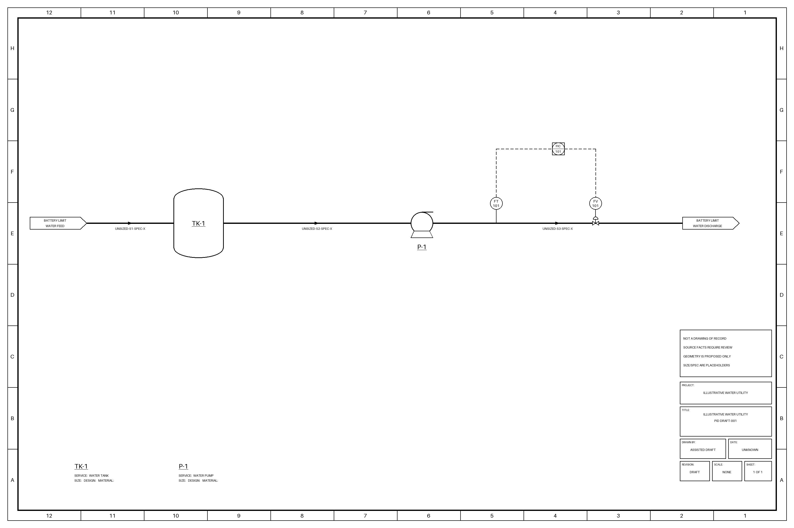

# Engineering Context Jumpstart

**Help engineers understand existing work, ask better questions and contribute knowledge others can use.**

Start with one engineering question, the records already available and a reviewer who knows the work. Use the
first brief to connect a qualified answer to its sources, missing evidence and next owner. Where asset models
are useful, the tools add draft identities, connections, investigation questions and portable snapshots.

This is a starting point for maintained engineering context: what exists, why a choice was made, what the records
support and what still needs review. P&IDs and process models are one specialist branch, and one foundation for
future digital twins and manufacturing applications.

## Start with one question

**Using company-approved Copilot, with no local software?** Copy the
[first-question brief](examples/first-pilot/README.md), select permitted sources and check the cited evidence.
You can begin with a document clarification; no asset model or custom agent is required.

**For leaders and managers:** use the [engineering onboarding guide](docs/ENGINEERING_ONBOARDING.md) to give an
engineer or intern one useful assignment, approved sources, a mentor/reviewer and a clear handoff. New engineers
can follow the same guide to reconstruct prior reasoning and return a source-backed contribution. No local
installation is required for the manual or company-approved Copilot path.

Manufacturing example: follow a pump from description to evidence request

**Want to see the tools connect?** [Follow one pump through the actual files](examples/from-description/assisted/PUMP_WALKTHROUGH.md):
description → authored model → draft drawing → investigation question → evidence request.
The example is illustrative. The [description guide](examples/from-description/README.md#try-the-connected-route-offline)
has the commands to build it offline with Python and the drawing dependencies; no model account is needed.

## Start wherever you are

Choose the guide for your starting records. Each guide states its setup, outputs and review needs.

| Your starting point | Start here |
|---|---|
| Documents and one question | [Investigate the sources and prepare a first brief](examples/first-pilot/README.md) |
| A written process description | [Author, check and build a draft model/drawing bundle](examples/from-description/README.md) |
| A P&ID image | [Try the supplied extraction offline, then use your own drawing](examples/own-drawing/README.md) |
| Supported DEXPI XML | [Read the structured export and inspect omissions](examples/from-dexpi-xml/README.md) |
| A controls loop list | [Compare the listed loops with the model or drawing](examples/loop-audit/README.md) |
| Historian CSVs | [Analyze recorded history and its false alarms](examples/historian-csv/README.md) |
| Labelled sheets and saved model answers | [Score an extraction against known answers](examples/vendor-evaluation/README.md) |

## What connects today: the hub and spokes

The tools have different input contracts. Descriptions need an engineer or approved assistant to author the
interpretation; a detailed draft P&ID also needs authored layout. Supported model JSON can feed questions,
platform staging and a portable graph. The graph supports source review, context packets and optional read-only
MCP access. It cannot currently regenerate every tool's input.

Use the [workflow and format map](docs/WORKFLOWS.md) to see the supported connections and manual steps.
The [feature reference](docs/FEATURES.md) lists the individual tools and reviewed examples.
For structured XML evidence, the optional [DEXPI source capture and local handoff](examples/from-dexpi-xml/README.md#optional-capture-structured-source-evidence)
keeps a complete policy-filtered packet beside the Native interpretation; capture is explicit and the default is unchanged.

## From a first assignment to shared engineering context

The [onboarding packet](examples/engineering-onboarding/README.md) gives engineers a selected landing map,
source-qualified records and starter workflows, without an asset model. Its three read-only tools can share
the [MCP entry point](examples/internal-mcp/README.md) with existing graph/context tools. This is a local snapshot
scaffold; shared company access and permissions remain integration work. Existing company systems retain
source authority, accepted decisions and continuing ownership. See the [lifecycle](docs/CONTEXT_LIFECYCLE.md)
and [example series](docs/README.md#engineering-work-examples).

## Status

These are prototypes tested on public inputs. Outputs are drafts for engineering review. No plant's own data,
operations review, PI import or measured operational benefit is established. The Ignition lab demonstration is
specific to Tennessee Eastman; its build command does not build your plant.

- **Use it:** [Documentation map](docs/README.md) · [Plan a company pilot](docs/AT_YOUR_PLANT.md)
- **Connect it:** [Choose an IT/OT path: approved Copilot, controlled exports or internal services](docs/INTERNAL_CONNECTIVITY.md)
- **Assess it:** [Results and limits](docs/RESULTS.md) · [Review the evidence](docs/REVIEWING.md)
- **Improve it:** [Contribute cases, model runs and tested changes](CONTRIBUTING.md)

Code is MIT; drawing-derived assets have their own terms in [NOTICE.md](NOTICE.md).
AI coding agents wrote most of the implementation; the [journal](docs/JOURNAL.md) records authorship and mistakes.

Read the [state of the toolkit](docs/STATUS.md) for working parts, open defects and unfinished integrations.

Links retained for earlier research references

### Results (held-out drawings, and how they were used)

Moved to [results and interpretation](docs/RESULTS.md#results-held-out-drawings-and-how-they-were-used).

### From a first packet to company context

See [from a first assignment to shared engineering context](#from-a-first-assignment-to-shared-engineering-context).

### Drawings only, process knowledge only, or both

See [supported workflows](docs/WORKFLOWS.md) and the [TE/OPEN100 demo comparison](docs/DELIVERABLES.md).

### Tutorial: reproduce it

Use the [research reproduction guide](docs/REPLICATE_AT_YOUR_PLANT.md).

### What's a tool and what's a record

Use the [documentation map](docs/README.md#reference-and-research-records) and [script reference](docs/SCRIPTS.md).

