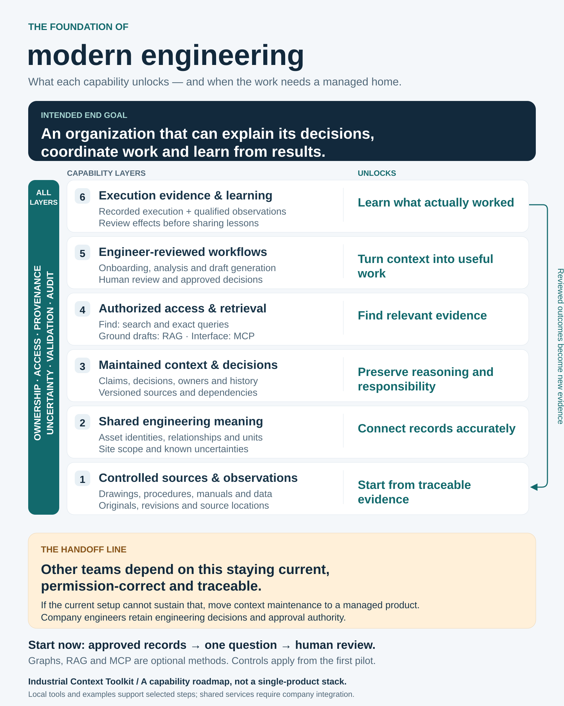

# Engineering Context Toolkit

**Turn your plant's existing records into engineering knowledge your team can build on.**

Start with selected records and one engineering question. Return a cited draft that separates what the records
support from interpretations and missing evidence, then identifies the next reviewer and source-change trigger.
That is a useful first contribution another engineer can continue.

**Try it without installing anything:** the [first-question guide](examples/first-pilot/README.md) gives a small
fictional worked result, its original records and a prompt for manual review or company-approved Copilot.
Substitute your permitted records when you understand the pattern. No model or process-data connection is needed.

For work that needs plant structure, use your own P&IDs, process descriptions or supported DEXPI exports to build
a sourced, reviewable draft model: the structural foundation of your plant's digital twin. Generate supported
engineering outputs, investigate missing information, analyze selected process data, and retain the evidence and
decisions behind the work. The [demo series](docs/DEMO_SERIES.md) connects these jobs without making every piece
a prerequisite. Public tutorials teach what to substitute at your plant; case studies retain their own evidence.

For a team assignment, the [organization starting guide](docs/ORGANIZATION_START.md) distinguishes ready-to-run
steps, source preparation and continuing ownership. [Dependencies](docs/DEPENDENCIES.md) vary by route.

| Choose a destination | What you get |
|---|---|
| **Tools — use your inputs** | [Choose a job below](#start-wherever-you-are); the [format map](docs/WORKFLOWS.md) states accepted inputs and generated outputs. |
| **Tutorials — learn, then substitute your records** | [P&ID to review bundle](examples/own-drawing/README.md), [description to draft drawing/model](examples/from-description/README.md), or [DEXPI to model](examples/from-dexpi-xml/README.md). |
| **Case studies and evaluation — inspect the evidence** | [TE/OPEN100 assembled examples](docs/DELIVERABLES.md), [results](docs/RESULTS.md), and [workflow/model comparisons](docs/README.md#reference-and-research-records). |

## Start wherever you are

These tools accept your own records in their documented formats. Choose the work product you need first.

| Your engineering job | Starting material and guide | Work product |
|---|---|---|
| Build your plant's first draft asset model | [P&ID image](examples/own-drawing/README.md) or [DEXPI XML](examples/from-dexpi-xml/README.md) | Sourced assets and represented connections, review material, graph and platform-staging routes. |
| Build from process knowledge | [Written description](examples/from-description/README.md) | An authored, source-linked model and layout, checked locally and rendered as draft P&ID sheets and exports. |
| Review and enrich the model | [Sourced statements](docs/STATEMENT_REVIEW.md) · [model correction and mapping](docs/REVIEW_LOOP.md) | Checkable claims, supported local corrections and supplied signal mappings. |
| Investigate controls or performance | [Loop list audit](examples/loop-audit/README.md) · [question engine](docs/OPPORTUNITY_SCREEN.md) · [process data and analytics](docs/PROCESS_ANALYTICS.md) | Explicit discrepancies, evidence requests, recorded-data bands and phase calculations beside the twin. |
| Estimate a measured change | [Impact calculation](examples/impact-estimate/README.md) | First-draft energy, cost and CO2e calculations with measurements, assumptions and constants visible. |
| Keep and exchange engineering context | [Context register](docs/CONTEXT_REGISTER.md) · [read-only MCP](examples/internal-mcp/README.md) · [owned team packets](examples/team-context/README.md) | Source dependencies, retained answers and selected snapshots to hand to the next team or company system. |
| Evaluate or improve a method | [Drawing comparison](examples/vendor-evaluation/README.md) · [task/model benchmarks](benchmarks/README.md) · [review a frozen model](benchmarks/source-support/artifact-values/README.md) | Compare saved answers against reviewed source/key cases, with missing answers, mistakes and evidence limits visible. |

## What connects today: the hub and spokes

1. **Build the draft.** An image route uses a supplied or approved-assistant extraction; a description route
   uses an engineer/assistant-authored model and layout; supported DEXPI XML is read directly. Each produces
   a documented model form. The [workflow map](docs/WORKFLOWS.md) shows which outputs that form supports.
2. **Review and enrich it.** Check source identities, asset relationships and missing items, make supported
   corrections, and add the independent process/controls evidence the investigation needs. Detailed drawing
   geometry and engineering interpretation remain authored work.
3. **Connect the useful parts.** Generate graph/context snapshots, draft Ignition/PI files and investigation
   material. Supply reviewed point identities and verify selected connections in an approved lab or receiving
   system. The [connectivity guide](docs/INTERNAL_CONNECTIVITY.md) covers permitted Copilot, local and IT/OT paths.
4. **Maintain the evidence and decisions.** Retain source versions, refresh affected answers explicitly and keep
   review history. Company systems own accepted records, permissions, releases and continuing responsibility.

The reusable generators build from the model you supply. The TE gateway builder and recorded replay assemble
one particular case study; use its architecture as a reference while following the tool guides for your plant's
model, mappings and target environment. The [feature reference](docs/FEATURES.md) lists individual tool evidence.

## Start with one question

The [first-question guide](examples/first-pilot/README.md) owns the no-install path and copyable brief.
Keep the result and the reasons behind it together; a saved note does not maintain itself when sources change.

Leaders and mentors can use the [onboarding guide](docs/ENGINEERING_ONBOARDING.md) to scope the assignment.
The [knowledge-only exercise](examples/engineering-onboarding/README.md) includes a worked evidence note and
a starter for your permitted records. The optional [contribution and revision tutorial](examples/engineering-onboarding/contribution-loop/README.md)
shows how to capture your selected text records and authored findings, preserve a combined answer's dependencies,
and reopen it when either source changes. It includes a fermentation-record example; practical team benefit remains unmeasured.

Tutorial: follow a pump from description to evidence request

[Follow one pump through the actual files](examples/from-description/assisted/PUMP_WALKTHROUGH.md):
description → authored model → draft drawing → investigation question → evidence request.
Then use the [own-description steps](examples/from-description/README.md#use-your-own-description-with-an-approved-assistant)
to substitute your source and authored response. The supplied pump is illustrative; it teaches the file contracts
and review process rather than establishing accuracy on your plant.

## From a first assignment to shared engineering context

The [foundation roadmap](docs/ENGINEERING_FOUNDATION.md) explains the intended end goal, optional RAG/MCP roles,
and the handoff when shared context needs a sustainably operated company product. No single product must own
every layer or replace the existing engineering and operations systems.

Keep the selected records and the reasons behind changes together as more people rely on them. The
[source-revision tutorial](examples/pump-revision/README.md) and [owned-team tutorial](examples/team-context/README.md)
show how supplied evidence reopens affected answers while preserving history and independent context.
Use the [lifecycle guide](docs/CONTEXT_LIFECYCLE.md) to plan the handoff into your company's maintained home.
For a small team, a whole site or a global network of 50–100 plants, use the
[scaling guide](docs/SCALING_ENGINEERING_CONTEXT.md): failure modes, upgrade signals, robustness checks and when
to evaluate a managed context/governance service alongside existing company systems.

## Status

The tools are prototypes tested on public and fictional inputs. Their output is a draft for engineering review;
site accuracy, installed signal identity, native platform acceptance and operational benefit need evidence from
your environment. Public benchmark numbers do not transfer automatically to a new drawing style or plant.

- **Use it:** [Documentation map](docs/README.md) · [Plan work at your plant](docs/AT_YOUR_PLANT.md)
- **Connect it:** [Approved clients and IT/OT paths](docs/INTERNAL_CONNECTIVITY.md)
- **Assess it:** [Results and limits](docs/RESULTS.md) · [Current implementation status](docs/STATUS.md)
- **Improve it:** [Contribute cases, model runs and tested changes](CONTRIBUTING.md)

Code is MIT; drawing-derived assets have their own terms in [NOTICE.md](NOTICE.md).
AI coding agents wrote most of the implementation; the [journal](docs/JOURNAL.md) records authorship and mistakes.

Links retained for earlier research references

### Results (held-out drawings, and how they were used)

Moved to [results and interpretation](docs/RESULTS.md#results-held-out-drawings-and-how-they-were-used).

### From a first packet to company context

See [from a first assignment to shared engineering context](#from-a-first-assignment-to-shared-engineering-context).

### Drawings only, process knowledge only, or both

See [supported workflows](docs/WORKFLOWS.md) and the [TE/OPEN100 demo comparison](docs/DELIVERABLES.md).

### Tutorial: reproduce it

Use the [research reproduction guide](docs/REPLICATE_AT_YOUR_PLANT.md).

### What's a tool and what's a record

Use the [documentation map](docs/README.md#reference-and-research-records) and [script reference](docs/SCRIPTS.md).

