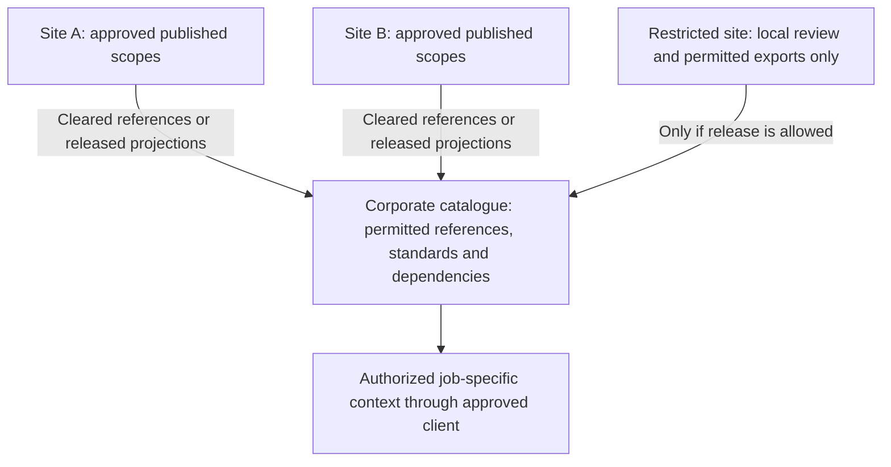

# From one engineering team to a global plant network

Build one useful contribution, then make it dependable for the people who inherit it. A small team can begin
with approved records, the toolkit and an existing company review process. A site needs coordination across
disciplines and shifts. An organization with 50–100 plants needs shared contracts and locally accountable
records, with controlled exchange across sites and regions.

**Move up when responsibility, risk or dependencies exceed the current controls, not at a particular headcount.**
A two-person team handling a controlled process change may need formal company approval immediately. A global
company may keep an isolated site's restricted work on approved local files indefinitely.

This is a recommended operating and architecture guide, not a demonstrated capacity claim. The repository
supplies reusable local tools and worked examples; it does not supply the site or global services described below.
Use [the lifecycle](CONTEXT_LIFECYCLE.md) for record ownership and maintenance, and
[connectivity](INTERNAL_CONNECTIVITY.md) for the permitted Copilot and IT/OT path at each site.
The [visual foundation roadmap](ENGINEERING_FOUNDATION.md) shows what each capability unlocks, the managed-product
handoff line and how a process/ops service can own a bounded context slice within the wider engineering ecosystem.

## Choose controls for three independent needs

| Need | Question to settle | What moving up means |
|---|---|---|
| Governance | Who may change, approve and rely on this record? | Accountable owners, authorized releases, conflict handling, inherited access and traceable decisions. |
| Connectivity | Where may the evidence be stored and processed, and how current must it be? | An approved export, replica or connector suited to that data class and site. More governance does not require a new OT connection. |
| Runtime capacity | Can the chosen tools meet the agreed workload and recovery needs? | Measured improvements, partitioning or a supported service. A faster script does not establish company authority. |

An internal MCP endpoint is an access interface. Its existence answers none of these questions by itself.

## What works at each organizational level

| Level | Practical starting setup | What starts to fail | Evidence that the next level is needed |
|---|---|---|---|
| **Small team / bounded assignment** | Approved source folder or existing document system; one question or unit; named investigator, reviewer and backup; one publisher per local register; versioned inputs and outputs. Use approved Copilot or manual review. Local scripts and selected MCP reads are optional. | Competing file edits, forgotten source revisions, reliance on one engineer's memory, unclear draft/release status, or sharing a packet with someone who lacks access to part of it. | A second writer, dependent team or restricted recipient cannot be handled reliably through the existing company process. Another engineer cannot reconstruct the result or take over while its author is absent. |
| **Whole plant site** | Discipline/unit-owned scopes, a site source and asset index, a published-revision catalogue, an authorized acceptance route and a review queue. Use existing document control, maintenance and change systems; add supported context coordination where they leave a real gap. | Process, controls, maintenance and quality use different revisions or identities; shift handovers miss pending changes; competing proposals overwrite each other; refreshes and connector failures disappear between owners. | Several sites rely on a common standard, asset family or decision, and site-by-site coordination cannot reliably identify applicable versions, exceptions, recipients or access boundaries. |
| **Organization with 50–100 plants globally** | Site-owned records and releases, common identity/schema contracts, a corporate catalogue of permitted published scopes and regional services where needed. Compose authorized context for a specific job. Share approved standards and learning while retaining site applicability and local exceptions. | Tags collide across sites; an acquired site uses different conventions; copied standards drift; restricted records cross regions; one central outage blocks everyone; a local observation is presented as a global conclusion. | Add or change regional isolation, service operations or integration capacity when measured load, recovery, residency or propagation requirements cannot be met. Plant count alone is not a justification for a larger central database. |

These are responsibility levels, not mandatory software tiers. Existing company systems may already provide
the necessary site or enterprise controls. Keep using them when they do. A small team still follows applicable
engineering, quality and change-control rules; its local `accepted` field cannot release a company change.

## Recognize the first failure, before it becomes routine

| Trigger | What to introduce or prove before relying on the expanded use |
|---|---|
| Two people propose changes to the same released scope | A single authorized publisher or a system that checks the base revision, retains both proposals and routes conflicts. A shared folder is not a concurrent editing database. |
| Another department consumes your output | An explicit dependency on the published version, receiving owner, pending-change notice and recorded disposition. Sending an email or changing a file does not prove receipt. |
| A source or user has a narrower access scope | Identity-backed authorization before retrieval, including derived records, indexes, caches, exports and logs; test revocation. Do not send the full packet and ask the assistant to hide restricted rows. |
| Refresh or delivery must run without its original author | An owned schedule, failure alerts, bounded retries, duplicate-safe processing, reconciliation and an acknowledged receiving revision. Preserve failures and pending work. |
| Records from multiple systems describe the same asset or change | Reviewed identity mappings and an authority table by record type. Exact source IDs, revisions and locators stay attached; matching tags or text do not establish equivalence. |
| A second site adopts a common workflow or standard | A versioned shared template, site applicability review, local deviation record and rollout owner. Do not silently replace a site's accepted configuration with a corporate default. |
| A decision cannot be reconstructed, access cannot be enforced, or an update overwrites accepted work | Stop relying on the affected path for that decision, retain the evidence and restore an authorized review/release route. Correct the control failure before expanding use. |

None of these triggers automatically calls for a new vendor. They identify a control the organization must
provide, either through existing systems, an internal service or a managed service.

## Design a global system around accountable local scopes

For a multi-site organization, our recommended pattern is **common contracts, local authority and selective
publication**. A corporate catalogue can tell an authorized engineer which published site records, standards,
prior decisions and workflow versions apply. It need not hold every original document or historian sample.

Arrows show permitted publication, not new network paths or automatic synchronization. Excluded sites and
unavailable evidence remain explicit in the returned scope. An offline site can use its authorized local
references and existing work process while the corporate service is unavailable; any retained copy shows its
as-of time and limitations. An outage must not silently turn an old answer into current operating evidence.

Agree a small common contract before connecting more plants:

- **Identity:** organization/site/unit namespace, stable equipment identity and reviewed source aliases. Keep
  source occurrence IDs distinct from engineering IDs; do not renumber every legacy source to force a join.
- **Meaning:** units, time zones, operating modes, equipment/model variants and local terminology. A corporate
  pattern describes a standard; it does not prove that each site installed that configuration.
- **Publication:** scope owner, accepted version, schema version, pending revisions, dependencies, access and
  permitted processing/storage region. The catalogue's metadata and citations can themselves be sensitive.
- **Change:** who assesses applicability, resolves disagreements, accepts a local deviation and acknowledges
  adoption. Corporate and local responsibilities must be explicit; a central update cannot release a site procedure.
- **Operation:** service owner, support, monitoring, restore targets, access review, version migration and exit/export
  route. Expand by controlled waves after representative sites pass the acceptance exercise.

Regional or independently operated service instances can limit an outage's reach and accommodate isolation and
release requirements. This adapts the isolation reasoning in Microsoft's
[deployment-stamps pattern](https://learn.microsoft.com/en-us/azure/architecture/patterns/deployment-stamp);
it does not prescribe Azure, one service per plant, or one database for the whole company. More instances add
fleet-management and integration cost. Choose boundaries for actual responsibilities and requirements.

## Make robustness observable

Robustness means preserving correct scope and recoverable history when something goes wrong. Faster retrieval
and larger context windows are useful only alongside those properties. The following are proposed receiving-system
acceptance exercises; the toolkit's public examples do not establish that a company system passes them.

| Property | Concrete acceptance exercise |
|---|---|
| Traceable evidence and authority | Have a replacement engineer reconstruct an answer from the exact source revision, locator, model/tool version, interpretation, reviewer and authorized release. Unknowns remain visible. |
| Conflict-safe publication | Submit two proposals from the same base. Retain both; refuse replacement of a newer accepted base and require an attributed resolution. |
| Explicit freshness and applicability | Introduce a source revision. Show the pending revision, affected answers/outputs, unchanged independent work, receiving acknowledgements and unresolved applicability. Distinguish source observation time, export time and publication time. |
| Permission-preserving retrieval | Use users with different site/discipline rights; remove one right. Check answers, citations, search results, caches, exports and logs. Source text and workflow instructions must not grant access or execute actions. |
| Recoverable integrations | Interrupt delivery after the receiver accepts it but before acknowledgement. Retry without duplicate decisions, retain a failed-delivery queue, and reconcile missed or out-of-order revisions without making an older version current. |
| Contained failure and restoration | Disconnect a source or region and restore from backup. Demonstrate the agreed recovery time and acceptable data-loss window, complete decision history, and explicit partial/unavailable results. |
| Safe rollout and useful learning | Pilot a template at materially different sites, retain local exceptions and roll back a failed release. Link executed changes and operating observations before claiming that an intervention worked. |

Repeated delivery should have one logical effect. Microsoft's
[idempotent-consumer guidance](https://learn.microsoft.com/en-us/azure/architecture/patterns/idempotent-consumer)
explains why retries require duplicate handling. A service still needs to prove its own transaction, acknowledgement
and reconciliation behavior; an identifier or an MCP connection alone is not a delivery guarantee.

Choose and record acceptable freshness, response time, review delay, recovery time and data-loss window for each
job with its owners. Measure source coverage, ambiguous identities, pending-change age, review backlog, delivery
failures, reconstruction effort and ongoing support effort against the team's baseline. Separate a correct access
refusal from missing permitted evidence. Do not select a universal target or infer capacity from plant count.
Missing observation/revision metadata stays unknown. Matching a content hash or restarting a server does not
establish that its sources are current enough for the job.

## Keep the IT/OT boundary at every level

Use the [environment decision table](INTERNAL_CONNECTIVITY.md#choose-the-data-path-before-the-assistant) per
site and data class. A global Copilot licence or company context service does not authorize cloud processing
of every source. A no-port plant can keep approved exports or local-only review; an existing approved replica
can support receiving-side analysis without a second collector. Derived findings require clearance too.

[NIST SP 800-82 Rev. 3](https://csrc.nist.gov/pubs/sp/800/82/r3/final) treats OT security alongside safety,
reliability and performance. Apply the site's approved segmentation and communication restrictions throughout
the design. Rev. 3 is the final publication referenced here; NIST also lists a Rev. 4 public draft. This guide
is not a site network design or a compliance assessment.

For approved IT records, Microsoft's [SharePoint agent access guidance](https://learn.microsoft.com/en-us/sharepoint/manage-access-agents-in-sharepoint)
distinguishes access to an agent from access to its data. Verify the chosen client's actual permissions and data
flows. A custom MCP service does not inherit those protections merely by being used with Copilot.

## When to involve a managed context and decision service

Consider a **managed engineering-context and decision-governance service** when maintaining shared evidence,
dependencies, access, ownership and release history has become a recurring operational responsibility that the
current arrangement cannot reliably sustain. Involve its architects before the first consequential shared
rollout if those controls are missing; do not wait for fifty plants or a preventable failure.

The useful transition is from preparing a contribution to operating the continuing company record. Such a
service should retain source-linked context, proposals, authorized decisions and change dependencies, and
return checked inputs to generation tools. It can coexist with existing document, maintenance, change and
execution systems. Those systems retain their authoritative records and statuses. Without actual execution and
observation records, the context service cannot establish which operational interventions succeeded.
Keep one authorized acceptance route per record; an imported review or copied status cannot grant execution approval.

| Choice | Good fit | Cost or limitation to assess |
|---|---|---|
| Existing company platforms plus the toolkit | Their document control, permissions and workflows already meet the job, and a named team can coordinate the remaining handoffs. | Manual reconciliation and custom integrations still need owners; test the complete loop rather than assuming existing licences cover it. |
| Internally operated context service | Distinctive requirements justify it and the organization can fund engineering, security, domain ownership and continuing operations. | Building the first integration is only part of the cost; upgrades, access changes, incident handling and connector maintenance continue. |
| Managed context/governance service | Shared context is useful, but maintaining dependable cross-system dependencies, review and service operations is exceeding the internal team's sustainable capacity. | Verify deployment/data-region options, integrations, support commitments, security, export/exit and total cost. Buying a service does not itself establish engineering truth or local acceptance. |

Start a service evaluation with one real recurring job and a bounded trial across two different scopes or sites.
Require a source revision, a conflicting proposal, access revocation, a failed/retried handoff, a receiving-system
readback and a complete export of accepted context/history. Measure coordination/review effort and maintenance
cost as well as retrieval quality. Agree success and stop criteria before the trial. If existing systems pass
and the additional service adds no useful outcome, keep the simpler arrangement.

## What this toolkit contributes today

The [tools and tutorials](../README.md#start-wherever-you-are) help an engineer create a sourced draft model,
questions, review material and portable context. The [owned-packet tutorial](../examples/team-context/README.md)
teaches scope boundaries and changed dependencies; the [acceptance plan](ACCEPTANCE.md) sets out proposed company
acceptance exercises, which have not been run here. These are useful starting mechanisms at any company size,
not a supplied global operating service.

The [snapshot reader](../examples/internal-mcp/README.md) loads selected files at startup, caps each selected
input at 32 MiB and bounds successful result data at 2 MiB. It has no company authentication, concurrent
publication, automatic source refresh or enterprise routing. Pagination does not make an oversized complete
record fit. Do not raise limits or expose the local listener as a substitute for a governed service.

Evaluate representative packet sizes, load/refresh latency, complete-record reads, memory, concurrent readers
and recovery in the intended environment. Select smaller published scopes or an appropriate receiving service
when requirements exceed that route. Neither these byte limits nor an algorithm improvement measures how many
plants or engineers a production service can support. Public software checks establish no company deployment,
human productivity or global-capacity result.

Architecture recommendations and linked primary documentation reviewed **November 1, 2026**. The operating
model is our proposed application of those principles; it is not an endorsement of a vendor or a proven deployment.
