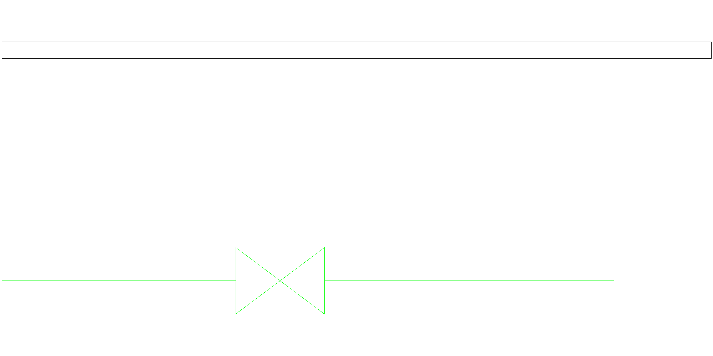

# LibreCAD attempt: rendering is not an accepted exchange

2026-11-06, Windows. **Partial observation; GUI open/edit/save remains not completed.**

The [subsequent diagnostic](native/diagnostic/README.md) separates ordinary TEXT rendering from attributes:
native PDF shows ordinary text, while attached values remain absent and the pinned parser lacks attribute
dispatch. LibreCAD 2.2.1.6 remains unqualified for this declared exchange. The repeated UI input attempt also
failed; no returned DXF or native acceptance is claimed.

LibreCAD 2.2.1.6 installed successfully through Windows Package Manager from the
[official publisher release](https://github.com/LibreCAD/LibreCAD/releases/tag/v2.2.1.6). The package manager
verified the installer SHA-256. The earlier installer rejection is no longer an installation blocker.

Two actual native command-line runs rendered the retained `worked/candidate.dxf`:

```text
LibreCAD.exe dxf2png --outfile proposed-render.png proposed-input.dxf
```

The repeated run exited 0 and produced the same PNG hash as the first. Exact input/output identities,
application hash and scope are in [receipt.json](native/receipt.json). The command uses LibreCAD's own
DXF reader/renderer, independently of the ezdxf writer/reader used by the existing proposal check.



The valve and line geometry appear. The expected tag, attribute values and title text are not readable in this
render; the top text region appears as an outline. The cause is not isolated: font/settings behavior and
attribute support still need inspection. A successful process exit and repeated image hash do not establish
visual completeness or preservation of editable data. This is one exposed authored fixture, not a corpus result.

The Windows UI automation tools could read the first-run Welcome dialog's accessibility tree, but screenshot
capture timed out (`FrameArrived timed out` / `window capture timed out`). A click returned
`coordinate input geometry is unavailable`; the alternate app interface reported
`window is not a usable app window`. Retrying a visible launch and the exposed Raise action did not recover
usable capture/input. No editor-made attribute edit or returned DXF was obtained. These are automation failures,
not findings that LibreCAD cannot edit the drawing.

Retained native stderr/stdout belong to the two conversion runs. The diagnostic line beginning
`LC_CrashHandler installed` announces a handler; it is not evidence of a crash. No crash was observed in the
conversion runs. No installer, application binaries or company files are included here.

Next, complete the [receiving checklist](RECEIVING_CHECK.md) in an interactive editor: inspect the missing text,
locate/edit the exact attributes, save/reopen, retain a returned DXF and run the existing comparison. Keep every
loss visible. No native-editor, intelligent-CAD project or company acceptance is established by this attempt.
