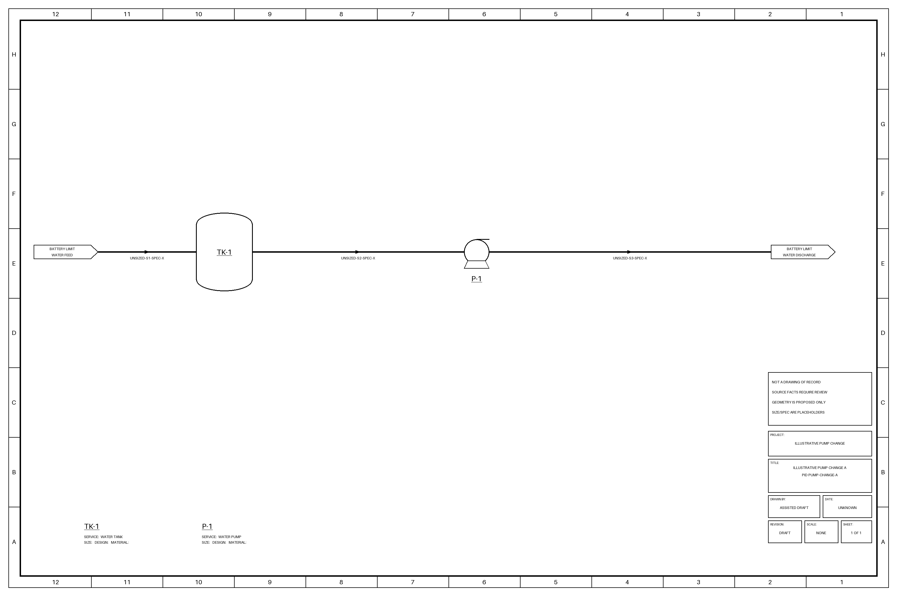
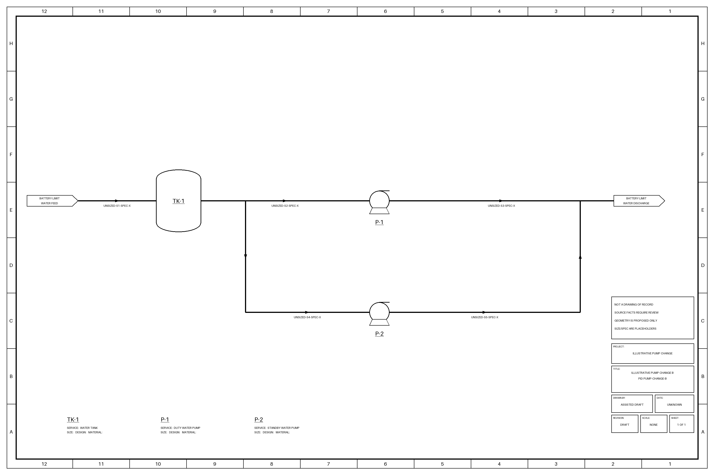

# Follow an engineering change beyond the drawing

**Fictional tutorial using existing tools.** A source record describes one water pump. A proposed revision adds
a second pump and parallel branches, with duty/standby service names. The engineer authors the changed model
and layout; the tools check their supported consistency, generate draft views, screen questions and reopen a
retained source answer when explicitly refreshed. That is how one reviewed interpretation can support several
engineering jobs without making each output an unrelated document.

| Design A: one pump | Proposed design B: duty/standby roles |
|---|---|
|  |  |

These are structural teaching drawings, not complete engineered duty/standby installations. Sizing, isolation,
nonreturn details, protection, electrical supply and control logic are unspecified. A standby label establishes
neither automatic changeover nor installed availability. The source records expressly leave these questions
open; no missing component is inferred to be absent from a real plant.

## What changes, and why it matters

| Part | Actual result | Engineering work still required |
|---|---|---|
| Source and interpretation | [A](inputs/A/source.txt) and [B](inputs/B/source.txt) retain distinct source bytes. Each [authored answer](inputs/B/answer.json) cites exact source lines and supplies its own geometry. | Check whether the source is current and the interpretation complete. Exact quotations do not prove engineering correctness. |
| Model and drawing | TK-1 and P-1 retain their IDs. B adds P-2, suction branch S4 and discharge branch S5. The detailed sheet and supported graph change after a new build. | Review hydraulic meaning, geometry, design requirements and omitted detail. No automatic drawing interpretation, detailed layout or complete impact analysis is demonstrated. |
| Platform staging | Both Ignition and PI files gain a P-2 equipment entry. Signal templates are empty because no instruments were specified. | Supply and verify actual signals, mappings and target-system acceptance. These are staging files, not an imported or connected application. |
| Generated question | The existing `C9@model` machine-record question names P-1 in A and P-1/P-2 in B. Its identity and question count stay the same while its scope changes. | Review the applicable existing machine/function records. The screen is not safety design, installed protection verification or an operating recommendation. |
| Retained answer | A fictional proposed, partial summary of A becomes stale/unanswered under explicit B refresh. Its complete decision and owner history remain. | A reviewer must decide what B supports; the tool does not invent a replacement answer or company approval. |
| Next engineer | The selected graph/context pair returns the changed assets, questions, source bindings and retained history through the pure Snapshot reader. | The company supplies identity, access, acceptance, ongoing revision monitoring and support. This tutorial starts no MCP server or transport. |

`ARRANGEMENT@TK-1` and `OPERABILITY@P-1` are **authored follow-up questions**. They remain visibly separate from
the actual generated catalog question. The operability question stays unanswered. The sources, interpretations,
key, service roles and fictional people were authored for this example; no human/site acceptance, model accuracy,
labor saving or plant performance was measured.

The graph keeps logical equipment/boundary stream endpoints; the exact tee positions remain in the authored
layout. `BL` is a symbolic endpoint reused by this format, not evidence that the upstream and downstream
boundaries are one physical header. A segment-resolved, validated network is separate work for hydraulic analysis.

## Run the example

Use an existing toolkit environment with Python 3.10+ and its drawing dependencies from `requirements.txt`.
From the repository root, choose an existing parent and a new output directory **outside this checkout**:

```sh
python -B examples/engineering-change/reproduce.py --out ../pump-change-run
```

No account, provider call, download, gateway, SDK or listener is used. The runner invokes the existing
description/context CLIs and the in-process Snapshot reader. It is a fixed fictional tutorial runner;
[the description workflow](../from-description/README.md#use-your-own-description-with-an-approved-assistant)
is the route for your own records.

Open `A/build/pid/D1.png`, `B/build/pid/D1.png`, `CHANGE-REVIEW.json`, then both `context/context.md` files.
The output keeps full build bundles, source packets, generated and composed questions, the original fictional
answer CSV, explicit refresh outputs, full reader responses and command logs. Keep the whole run when passing
it to another reviewer. Runtime logs can contain local paths and clocks; they are not an automatic public export.

The runner also checks actual refusals: an A answer against B's source, a B stream whose model endpoint
contradicts its drawing route, an old context answer CSV under the changed evidence fingerprint, and both
mixed A/B graph/context pairs. Inputs and the selected production tool files stay unchanged. These controls
establish selected software behavior, not correct source interpretation or safe design.

The [saved change review](expected/CHANGE-REVIEW.json) and selected `expected/A` / `expected/B` artifacts come
from an actual run. The [acceptance key](ACCEPTANCE.json) and [provenance](PROVENANCE.json) explain their authored,
development status and the corrected initial expectation. Reproduction selects today's catalog and records its
identity in each build. A later tool/catalog change needs explicit review of any changed result; do not silently
overwrite the earlier evidence to make a check pass.

## Apply the method in your company

With manual review or approved Copilot, start by comparing permitted source revisions. Record stable local
identities, the proposed change, affected work products, unknowns, reviewer roles and the decision needed. Ask
Process, E&I, Maintenance and Operations which existing records govern their part. A two-pump sketch alone
cannot tell you whether a procedure, electrical circuit, common failure or protective function is adequate.

For local generation, prepare each source using the existing description workflow. Have an engineer or
approved assistant author and review the model/layout, then build a fresh bundle. Keep the original source and
answer rather than replacing A with B. Add source-bound questions and reviewed interpretations through the
[context register](../../docs/CONTEXT_REGISTER.md), then explicitly refresh and inspect what reopens.
Stable tags in this fixture are supplied identities, not a general company identity resolver.

The distinction between **as-designed, as-installed and as-operated** remains essential. Design B is a proposal;
a generated drawing or a context decision cannot authorize work, establish execution, or prove a pump ran.
Use the company's existing change, commissioning and operating records for those claims.

At team scale, name a publisher, reviewer, receiving owner and next revision check. At site scale, use
[owned departmental packets](../team-context/README.md) to make the dependencies explicit. Across sites, review
site-qualified identities and local applicability before adopting a shared template. Evaluate a supported company
service when people depend on this information staying current and access-correct beyond the original author.
See [scaling](../../docs/SCALING_ENGINEERING_CONTEXT.md) and [connectivity](../../docs/INTERNAL_CONNECTIVITY.md)
for the decision criteria and strict IT/OT paths. No new OT connection is needed for this offline exercise.

Continue with the [demo series](../../docs/DEMO_SERIES.md) to connect the separate source, analysis, onboarding
and cross-team examples. They teach a common method; they are not one already integrated plant application.
