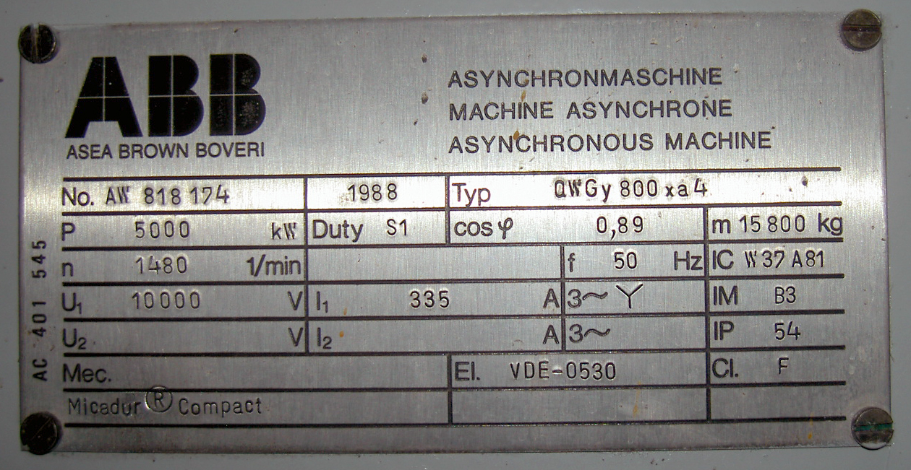
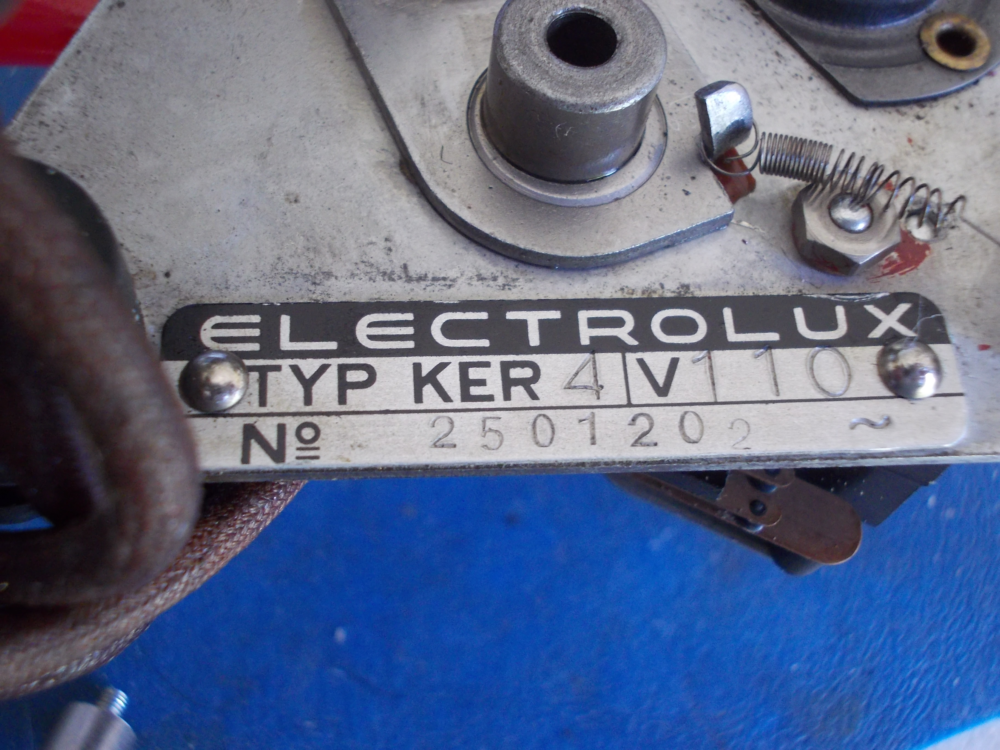

# From a photograph to candidate asset information

**Two public-source exercises, not a plant trial.** One photograph is an industrial ABB asynchronous-machine
plate described by its uploader as being at Berlin-Moabit power station. The other is an Electrolux motor in a
wire recorder. They teach source retention and field review; two exposed photographs cannot establish site
accuracy, installed identity or performance on unseen nameplate families.

## Industrial motor plate



Photo: [Denis Apel, via Wikimedia Commons](https://commons.wikimedia.org/wiki/File:Typenschild-Drehstrom-Asynchronmaschine_apel.jpg),
[CC BY-SA 2.0 Germany](https://creativecommons.org/licenses/by-sa/2.0/de/deed.en). The original is unchanged;
no endorsement is implied. The page's date is unknown. Its station description is attributed context, not a
verified present-day asset association.

The [industrial provenance](source/industrial-PROVENANCE.json) pins the bytes; the
[candidate field sheet](industrial-fields.csv) retains manufacturer, plate number, power, voltage, current,
speed and frequency with image locators. These are session-assistant visual readings awaiting independent review.
The generic whole-image OCR returned only a fragment of the machine description, despite a mean word confidence
of 75.1 in this run. It omitted the numeric equipment data. A second segmentation mode is retained too;
see [all six attempts](worked/public-cases/receipt.json). No field-accuracy percentage is inferred from confidence.

## Recorder motor plate and a harder OCR failure



Photo: [tony_duell, 3 July 2018, via Wikimedia Commons](https://commons.wikimedia.org/wiki/File:Motor_Nameplate.jpg),
[CC BY 2.0](https://creativecommons.org/licenses/by/2.0/). The original is unchanged. The worked crop is a
grayscale/contrast derivative; its rectangle and recipe are retained. No endorsement is implied.

## Inspect before automating

The [original provenance](source/PROVENANCE.json) binds the downloaded bytes. The
[candidate field sheet](candidate-fields.csv) records visual transcription by the session assistant, with
pixel locators and unresolved interpretation. It is **not independently human-reviewed**. The plate's `N°`
number is retained as a printed number; its role as a serial or part number is not established by the image.
There is no plant tag, site/unit association or verified capture-to-asset link, so no CMMS record is emitted.

The [saved OCR receipt](worked/public-cases/receipt.json) retains every declared attempt. The whole-image PSM 3 run
found no text; the crop and alternate segmentation settings produced incomplete or incorrect text. Exit 0,
nonempty text and OCR confidence are not field acceptance. These failures are kept alongside the readable image.

## Replay it

Install the repository requirements and [Tesseract](https://tesseract-ocr.github.io/tessdoc/Installation.html)
with English data, then run from the repository root. Tesseract is a separate optional application; if absent,
the replay reports NOT RUN rather than passing. No network or model call occurs during replay.

```sh
python examples/photo-to-record/replay.py --out out/photo-to-record
```

The command retains six attempts (recorder whole image PSM 3 and crop PSM 3, 6 and 11; industrial whole image
PSM 3 and 6), engine version, source/crop
and output hashes, stderr and exact preprocessing settings. Different Tesseract builds may produce different
text; inspect your retained output rather than expecting this Windows build's bytes.

The generic document route also works on your images and scans:

```sh
python scripts/extract_text.py examples/photo-to-record/source/motor-nameplate.jpg --ocr auto --out out/photo-text
```

That command reads text, not structured equipment identity. For paper records use the same
[document-text guide](../../docs/DOCUMENT_TEXT.md), preserving page locators and originals.

## Use the method at a plant

Capture the equipment view, site/unit/tag context, nameplate close-up and useful attachments as a declared
group. Record observer/date, original hashes, the position versus installed physical unit, and each field's
locator. Keep unreadable values empty and near matches unresolved. Confirm units and digits against the image;
do not turn a model/type number into a serial number by assumption.

Have a responsible person review the candidate fields and their equipment association before proposing an
equipment-record correction. Compare with the existing register and datasheet through the
[maintenance workflow](../../docs/MAINTENANCE_START.md). Preserve conflicting values and the earlier installed
unit when equipment is replaced. A photo cannot prove hidden pipe connections or a control function.

Before quoting accuracy or savings, freeze permitted sources and a separately reviewed field key across
unfamiliar equipment families. Retain wrong digits/units, false asset matches, omissions, abstentions and total
capture/review/rework effort. These small exposed examples supply none of those generalization claims.
